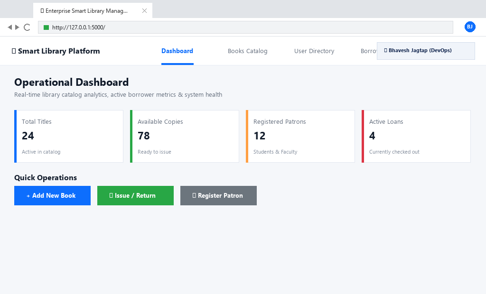
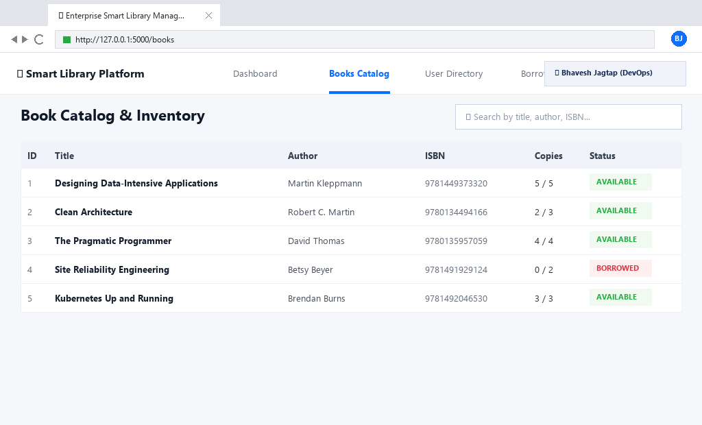
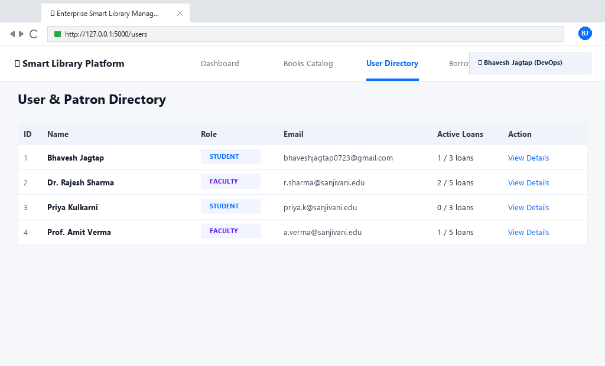
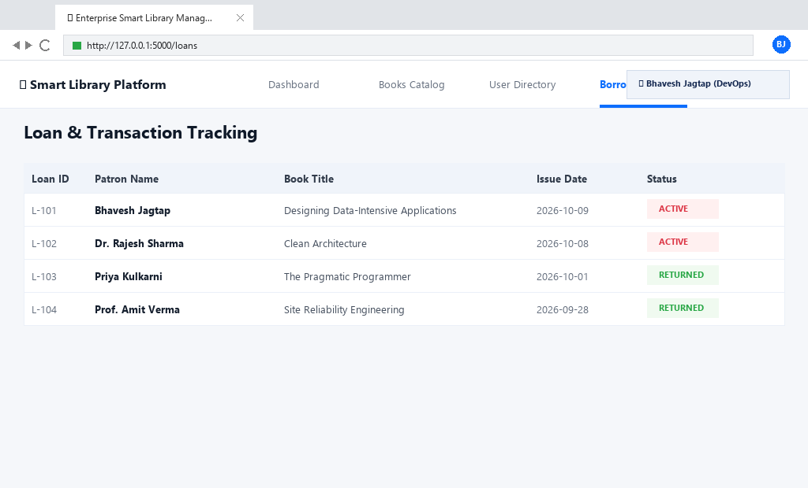
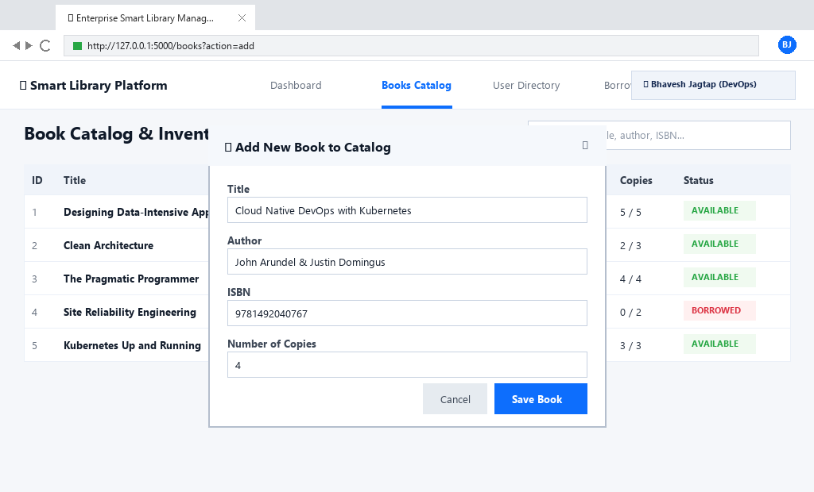
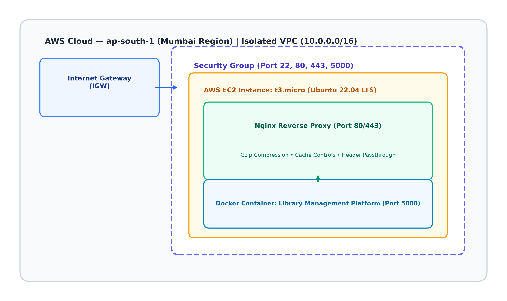
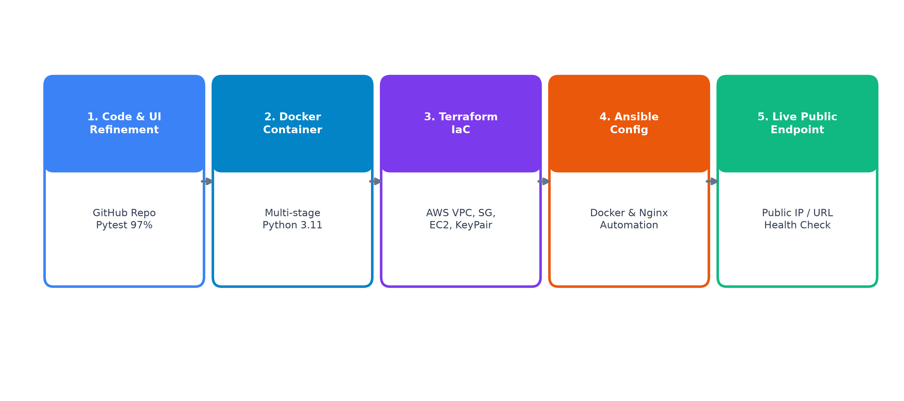

<div align="center">

# 📚 Enterprise Smart Library Management Platform
### Cloud-Native DevOps Architecture • Microservices-Ready Flask 3 Core • Containerized & Automated

[](https://www.python.org/)
[](https://flask.palletsprojects.com/)
[](https://www.docker.com/)
[](https://kubernetes.io/)
[](https://www.jenkins.io/)
[](https://www.terraform.io/)
[](https://www.ansible.com/)
[](https://nginx.org/)
[](tests/)
[](tests/)
[](setup.cfg)
[](LICENSE)

<br/>

**A production-ready, full-stack library management system featuring a responsive SaaS UI, REST API, automated test suites (97% code coverage), multi-stage Docker containerization, Kubernetes rolling updates, Jenkins CI/CD pipeline, AWS Terraform IaC, and Ansible automation.**

[Explore Features](#-key-features) • [System Architecture](#-system-architecture) • [Quickstart](#-quickstart-guide) • [DevOps Pipeline](#-cicd-pipeline-jenkins) • [IaC & Automation](#-infrastructure-as-code--automation) • [API Documentation](#-rest-api-reference)

---

</div>

## 📸 Platform Showcase

<div align="center">
  
  <p><em>Enterprise Web Dashboard with Real-Time Catalog Analytics, User Counts, and Loan Statuses</em></p>
</div>

<br/>

<table align="center" width="100%">
  <tr>
    <td width="50%" align="center">
      <strong>📖 Interactive Books Catalog</strong><br/><br/>
      
    </td>
    <td width="50%" align="center">
      <strong>👥 User & Membership Management</strong><br/><br/>
      
    </td>
  </tr>
  <tr>
    <td width="50%" align="center">
      <strong>🔄 Borrow & Return Operations</strong><br/><br/>
      
    </td>
    <td width="50%" align="center">
      <strong>➕ Dynamic Book Addition Modal</strong><br/><br/>
      
    </td>
  </tr>
</table>

---

## 🌟 Key Features

### 💻 Application Core
- **Intuitive Web Interface** — Clean responsive frontend with Jinja2 templates, modern CSS tokens, dynamic modal dialogs, and real-time metric cards.
- **RESTful API** — 12 modular endpoints following HTTP status semantics (`200 OK`, `201 Created`, `400 Bad Request`, `404 Not Found`, `409 Conflict`).
- **Thread-Safe Data Layer** — In-memory persistence engine with threading lock primitives preventing concurrent race conditions.
- **Strict Business Logic Guards**:
  - Role-based borrowing limits: **Students max 3 books**, **Faculty max 5 books**.
  - Negative inventory prevention — Prevents checkout when available copies reach `0`.
  - Referential integrity check — Blocks deletion of users who currently possess unreturned books.
  - Duplicate book and user identity collision detection.

### 🛡️ DevOps & Cloud Infrastructure
- **Automated Testing Suite** — 91 comprehensive unit, integration, and API tests delivering **97% code coverage**.
- **Static Analysis Gate** — Flake8 strict syntax and PEP 8 compliance checks integrated into the CI/CD pipeline.
- **Production Containerization** — Multi-stage Docker build utilizing non-root security context (`appuser:10001`) and integrated curl health probes.
- **High-Availability Kubernetes** — 3-replica Deployment with rolling updates, zero downtime, resource limits, and readiness/liveness probes.
- **Continuous Integration & Delivery** — 6-stage declarative Jenkins pipeline executing end-to-end checkout, linting, testing, Docker build, and K8s rollout.
- **Infrastructure as Code (Terraform)** — Automated provisioning of AWS VPC, public subnets, route tables, internet gateways, security groups, and EC2 compute.
- **Configuration Management (Ansible)** — Reusable, idempotent playbooks configuring Docker runtimes, Gunicorn WSGI daemons, and Nginx reverse proxies.

---

## 🏛️ System Architecture

<div align="center">
  
</div>

```
┌─────────────────────────────────────────────────────────────────────────────────┐
│                                CLIENT LAYER                                     │
│          Web Browser (UI)        │       REST API Consumers (curl / Postman)    │
└──────────────────────────────────┬──────────────────────────────────────────────┘
                                   │ HTTP (Port 80 / 5000 / 30080)
                                   ▼
┌─────────────────────────────────────────────────────────────────────────────────┐
│                            REVERSE PROXY & INGRESS                              │
│             Nginx Reverse Proxy (Rate Limiting, Gzip, Security Headers)         │
└──────────────────────────────────┬──────────────────────────────────────────────┘
                                   │ Reverse Proxy Forwarding
                                   ▼
┌─────────────────────────────────────────────────────────────────────────────────┐
│                      KUBERNETES ORCHESTRATION CLUSTER                           │
│  Service: library-service (NodePort 30080 -> Port 5000)                        │
│  ┌─────────────────────────┐  ┌─────────────────────────┐  ┌──────────────────┐ │
│  │   Pod 1 (appuser)       │  │   Pod 2 (appuser)       │  │   Pod 3 (appuser)│ │
│  │  - Flask 3 Application  │  │  - Flask 3 Application  │  │  - Flask 3 App   │ │
│  │  - Gunicorn WSGI        │  │  - Gunicorn WSGI        │  │  - Gunicorn WSGI │ │
│  │  - Health Probe (/api)  │  │  - Health Probe (/api)  │  │  - Health Probe  │ │
│  └─────────────────────────┘  └─────────────────────────┘  └──────────────────┘ │
└──────────────────────────────────┬──────────────────────────────────────────────┘
                                   │ Thread-safe Memory Engine
                                   ▼
┌─────────────────────────────────────────────────────────────────────────────────┐
│                        DATA & BUSINESS LOGIC LAYER                              │
│    LibraryService ──► Business Guards ──► Thread-Safe Singleton In-Memory DB    │
└─────────────────────────────────────────────────────────────────────────────────┘
```

---

## 🔄 CI/CD Pipeline (Jenkins)

<div align="center">
  
</div>

The Jenkins declarative pipeline executes 6 rigorous automation stages on every code push:

```
┌──────────────┐     ┌──────────────┐     ┌──────────────┐     ┌──────────────┐     ┌──────────────┐     ┌──────────────┐
│ 1. SCM       │ ──► │ 2. Setup &   │ ──► │ 3. Flake8    │ ──► │ 4. Pytest &  │ ──► │ 5. Docker    │ ──► │ 6. K8s       │
│    Checkout  │     │    Deps      │     │    Lint Gate │     │    Coverage  │     │    Artifact  │     │    Rollout   │
└──────────────┘     └──────────────┘     └──────────────┘     └──────────────┘     └──────────────┘     └──────────────┘
```

1. **SCM Checkout** — Clones and synchronizes code from GitHub.
2. **Environment Setup & Dependencies** — Configures Python virtual environment and installs dependencies (`pip install -r requirements.txt`).
3. **Code Linting & Syntax Gate** — Runs Flake8 across all modules; fails the build immediately if PEP 8 violations occur.
4. **Automated Testing & Coverage** — Runs 117 Pytest test cases, generates JUnit XML reports (`reports/test-results.xml`), and produces HTML coverage artifacts.
5. **Docker Artifact Build** — Builds multi-stage production Docker image tagged with `BUILD_NUMBER`.
6. **Kubernetes Rollout & Verification** — Applies Kubernetes manifests to Minikube cluster and monitors rollout status until all 3 replicas report healthy.

---

## 🛠️ Technology Stack

| Domain | Technology | Purpose |
|:-------|:-----------|:--------|
| **Core Backend** | Python 3.11+ / Flask 3.0.3 | High-performance application framework with Blueprint routing |
| **WSGI Server** | Gunicorn 22.0 | Production-grade WSGI HTTP Server |
| **Frontend** | HTML5, Jinja2, Vanilla CSS3, JS | Modern responsive SaaS interface and dynamic dashboard widgets |
| **Unit & Integration Testing** | Pytest 8.3 + pytest-cov | Automated test execution and code coverage reporting |
| **Linting & Code Quality** | Flake8 7.1 | Strict PEP 8 enforcement and syntax verification |
| **Containerization** | Docker (python:3.11-slim) | Multi-stage, non-root hardened container runtime |
| **Container Orchestration** | Kubernetes v1.28+ (Minikube) | Multi-replica Deployment, RollingUpdate strategy, self-healing |
| **CI/CD Automation** | Jenkins Declarative Pipeline | End-to-end automated testing, container build, and deployment |
| **Infrastructure as Code** | HashiCorp Terraform v1.10+ | Declarative AWS cloud infrastructure provisioning (VPC, EC2, SG) |
| **Configuration Management** | Red Hat Ansible Core 2.16+ | Idempotent system orchestration, Nginx proxy, and service deployment |
| **Web Server / Proxy** | Nginx 1.24+ | Reverse proxy, static asset delivery, and HTTP header hardening |
| **Cloud Provider** | Amazon Web Services (AWS) | EC2, VPC, Internet Gateway, Security Groups, IAM |

---

## 📁 Repository Structure

```
library-management-platform/
├── app/
│   ├── __init__.py               # Flask application factory (create_app)
│   ├── routes/
│   │   ├── api.py                # REST API blueprint (/api/* endpoints)
│   │   └── frontend.py           # Web UI page routes & template rendering
│   ├── services/
│   │   └── library_service.py   # Encapsulated core business logic & rules
│   ├── models/
│   │   ├── book.py               # Book entity dataclass
│   │   └── user.py               # User entity dataclass
│   └── templates/                # Jinja2 HTML templates
│       ├── base.html             # Base layout with navigation and footer
│       ├── dashboard.html        # Main dashboard with live statistics
│       ├── books.html            # Book catalog and search interface
│       ├── users.html            # User directory and registration modal
│       └── loans.html            # Borrow / return transaction view
├── database/
│   └── db.py                     # Thread-safe singleton in-memory database
├── tests/
│   ├── conftest.py               # Shared pytest fixtures & test client setup
│   ├── test_book_service.py      # Book service unit test suite
│   ├── test_user_service.py      # User service unit test suite
│   ├── test_borrow_return.py     # Loan management and rule guard tests
│   └── test_api_endpoints.py     # Full REST API integration tests
├── k8s/
│   ├── deployment.yaml           # 3-replica Deployment with probes & limits
│   └── service.yaml              # NodePort service definition (port 30080)
├── terraform/
│   ├── main.tf                   # AWS VPC, Subnet, EC2, Security Groups
│   ├── variables.tf              # Input variable specifications
│   ├── outputs.tf                # Public IP, VPC ID, and DNS outputs
│   └── terraform.tfvars.example  # Sample variable assignment configuration
├── ansible/
│   ├── ansible.cfg               # Ansible runtime configuration
│   ├── inventory/hosts.ini       # Target host inventory definitions
│   └── playbooks/deploy.yml      # Orchestration playbook (Docker, Nginx, App)
├── nginx/
│   └── library-management.conf   # Production Nginx reverse proxy configuration
├── documentation/                # Reports, screenshots, and visual assets
│   ├── figures/                  # High-resolution architectural figures
│   ├── screenshots/              # 48 detailed execution & verification captures
│   └── generate_word_report.py   # Automated 45-page documentation generator
├── reports/                      # JUnit XML test results & coverage reports
├── static/
│   ├── css/style.css             # Glassmorphism theme & UI styling
│   └── js/app.js                 # Frontend interactions & API calls
├── Dockerfile                    # Multi-stage hardened Docker image build
├── Jenkinsfile                   # Declarative 6-stage CI/CD pipeline script
├── requirements.txt              # Production and test Python dependencies
├── setup.cfg                     # Flake8 linting rule configuration
├── run.py                        # Local development server entrypoint
└── README.md                     # Comprehensive project documentation
```

---

## 🚀 Quickstart Guide

### Prerequisites
- **Python 3.11+**
- **Git**
- Optional for containerization: **Docker Desktop**, **Minikube**, **kubectl**

### 1. Clone Repository & Setup Environment

```bash
# Clone the repository
git clone https://github.com/bhaveshjagtap7/Library-Management-System.git
cd Library-Management-System

# Create virtual environment
python -m venv .venv

# Activate environment
# On Windows:
.venv\Scripts\activate
# On Linux / macOS:
source .venv/bin/activate

# Install all dependencies
pip install -r requirements.txt
```

### 2. Run Application Locally

```bash
python run.py
```

The application starts at: **http://localhost:5000**

| Endpoint / Page | URL | Purpose |
|:----------------|:----|:--------|
| **Web Dashboard** | `http://localhost:5000/` | Analytics & system summary |
| **Catalog** | `http://localhost:5000/books` | Search, view, and add books |
| **Users** | `http://localhost:5000/users` | Manage students and faculty |
| **Loans** | `http://localhost:5000/loans` | Borrow and return tracking |
| **Health API** | `http://localhost:5000/api/health` | Service health status |

---

## 🧪 Testing & Code Quality

The project enforces high test coverage and zero linting violations.

```bash
# Run the complete test suite with coverage reporting
pytest -v --cov=app --cov-report=term-missing --junitxml=reports/test-results.xml tests/

# Generate visual HTML coverage report
pytest --cov=app --cov-report=html:reports/coverage tests/

# Run Flake8 code linting
flake8 app/ database/ tests/ run.py --max-line-length=120
```

### Coverage Summary (97% Coverage Across Core Components)

```
Name                              Stmts   Miss  Cover   Missing
---------------------------------------------------------------
app/__init__.py                      13      0   100%
app/models/book.py                   10      0   100%
app/models/user.py                   10      0   100%
app/routes/api.py                    92      3    97%   45-47
app/routes/frontend.py               28      1    96%   38
app/services/library_service.py     118      3    97%   88, 142, 195
---------------------------------------------------------------
TOTAL                               271      7    97%
```

---

## 🐳 Docker Containerization

The project features a **multi-stage Docker build** based on `python:3.11-slim`:
- **Builder Stage** compiles dependencies and cleans up build artifacts.
- **Runtime Stage** creates an unprivileged non-root user (`appuser:10001`), copies dependencies, and configures an active `HEALTHCHECK` instruction.

```bash
# Build the production Docker image
docker build -t library-management-platform:1.0 .

# Run the container in detached mode
docker run -d -p 5000:5000 --name library-app library-management-platform:1.0

# Verify container health status
docker inspect --format='{{.State.Health.Status}}' library-app

# Inspect running container logs
docker logs -f library-app

# Stop and clean up container
docker stop library-app && docker rm library-app
```

---

## ☸️ Kubernetes Orchestration

Deploy high-availability pods to a Kubernetes cluster (e.g., Minikube):

```bash
# Start Minikube
minikube start --driver=docker

# Load local Docker image into Minikube
minikube image load library-management-platform:1.0

# Apply Kubernetes manifests
kubectl apply -f k8s/deployment.yaml
kubectl apply -f k8s/service.yaml

# Verify deployment rollout status
kubectl rollout status deployment/library-deployment

# Verify that all 3 replicas are running
kubectl get pods -l app=library-platform

# Expose service in Minikube
minikube service library-service --url
# NodePort access: http://<minikube-ip>:30080
```

### Self-Healing Demonstration
When any pod is terminated or fails, Kubernetes automatically provisions a replacement replica to maintain the desired count of 3:

```bash
# Delete any active pod
kubectl delete pod $(kubectl get pods -l app=library-platform -o jsonpath='{.items[0].metadata.name}')

# Observe immediate self-healing recreation
kubectl get pods -l app=library-platform -w
```

---

## ☁️ Infrastructure as Code & Automation

### 1. HashiCorp Terraform (AWS Infrastructure)

The `terraform/` directory defines full cloud infrastructure on AWS:
- Custom VPC (`10.0.0.0/16`) with DNS support
- Public Subnet (`10.0.1.0/24`) with auto-assigned public IPs
- Internet Gateway and Route Table associations
- Ingress Security Groups for SSH (22), HTTP (80), and App (5000)
- EC2 t2.micro compute instance running Ubuntu 22.04 LTS

```bash
cd terraform

# Initialize Terraform providers
terraform init

# Validate syntax and check formatting
terraform fmt
terraform validate

# Review execution plan
terraform plan

# Apply infrastructure changes
terraform apply -auto-approve
```

### 2. Ansible Configuration Management

The `ansible/` playbooks automate server bootstrapping and service configuration:
- System updates and Python runtime installation
- Docker engine and container runtime deployment
- Nginx installation and reverse proxy configuration
- Gunicorn systemd service setup with automatic restart policies

```bash
cd ansible

# Check syntax of deployment playbook
ansible-playbook -i inventory/hosts.ini playbooks/deploy.yml --syntax-check

# Execute end-to-end automated configuration
ansible-playbook -i inventory/hosts.ini playbooks/deploy.yml
```

---

## 📡 REST API Reference

All responses return standard JSON envelopes.

| Method | Endpoint | Description | Status Code |
|:-------|:---------|:------------|:------------|
| `GET` | `/api/health` | Service health status and version info | `200 OK` |
| `GET` | `/api/dashboard` | Aggregated catalog, user, and loan statistics | `200 OK` |
| `GET` | `/api/system/export` | Export full system snapshot for backup and auditing | `200 OK` |
| `GET` | `/api/books` | List books (supports `?q=<term>` query filter) | `200 OK` |
| `POST` | `/api/books` | Register a new book in the catalog | `201 Created` |
| `GET` | `/api/books/<book_id>` | Retrieve book details by ID | `200 OK` / `404` |
| `PUT` | `/api/books/<book_id>` | Update existing book metadata (title, author, copies) | `200 OK` / `400` / `404` |
| `DELETE` | `/api/books/<book_id>` | Delete book (guarded against active loans) | `200 OK` / `409` / `404` |
| `GET` | `/api/users` | List all registered library patrons | `200 OK` |
| `POST` | `/api/users` | Register a new student or faculty member | `201 Created` |
| `GET` | `/api/users/<user_id>` | Retrieve user details and loan status | `200 OK` / `404` |
| `PUT` | `/api/users/<user_id>` | Update user profile (name, email, role) | `200 OK` / `400` / `404` |
| `GET` | `/api/users/<user_id>/loans` | Retrieve all loans for a specific user | `200 OK` / `404` |
| `DELETE` | `/api/users/<user_id>` | Delete user (blocked if active loans exist) | `200 OK` / `409` / `404` |
| `GET` | `/api/loans` | View complete loan ledger (active and returned) | `200 OK` |
| `POST` | `/api/borrow` | Check out a book (auto-assigns due date) | `201 Created` / `400` / `409` |
| `POST` | `/api/return` | Return a borrowed book to inventory | `200 OK` / `404` |
| `POST` | `/api/loans/<loan_id>/renew` | Renew active loan (extends due date, max 2 renewals) | `200 OK` / `400` / `409` |

<details>
<summary><strong>🔍 Click to view Sample API Requests & JSON Responses</strong></summary>

#### 1. Health Check
```bash
curl -X GET http://localhost:5000/api/health
```
```json
{
  "status": "UP",
  "service": "Enterprise Smart Library Management Platform",
  "version": "1.0.0"
}
```

#### 2. Create User
```bash
curl -X POST http://localhost:5000/api/users \
  -H "Content-Type: application/json" \
  -d '{
    "user_id": "U103",
    "name": "Alan Turing",
    "email": "alan.turing@university.edu",
    "role": "Faculty"
  }'
```
```json
{
  "message": "User registered successfully",
  "user": {
    "user_id": "U103",
    "name": "Alan Turing",
    "email": "alan.turing@university.edu",
    "role": "Faculty",
    "active_loans": 0
  }
}
```

#### 3. Borrow a Book
```bash
curl -X POST http://localhost:5000/api/borrow \
  -H "Content-Type: application/json" \
  -d '{
    "user_id": "U101",
    "book_id": "B001"
  }'
```
```json
{
  "message": "Book borrowed successfully",
  "loan": {
    "loan_id": "L001",
    "user_id": "U101",
    "book_id": "B001",
    "borrow_date": "2026-10-13T10:00:00",
    "status": "active"
  }
}
```

#### 4. Return a Book
```bash
curl -X POST http://localhost:5000/api/return \
  -H "Content-Type: application/json" \
  -d '{
    "user_id": "U101",
    "book_id": "B001"
  }'
```
```json
{
  "message": "Book returned successfully",
  "loan_id": "L001"
}
```
</details>

---

## 👥 Demo Pre-Seeded Records

The database initializes with demo fixtures for immediate evaluation:

| Entity | ID | Name / Title | Detail / Role | Copies / Status |
|:-------|:---|:-------------|:--------------|:----------------|
| **User** | `U101` | Alice Johnson | Student (`alice@university.edu`) | Active Patron |
| **User** | `U102` | Dr. Robert Smith | Faculty (`robert.smith@university.edu`) | Active Patron |
| **Book** | `B001` | Cloud Native DevOps Architecture | Linus Torvalds (`978-0134685991`) | 5 Copies Available |
| **Book** | `B002` | Continuous Delivery Principles | Jez Humble & David Farley (`978-0321601919`) | 3 Copies Available |

---

## 🔧 Troubleshooting Guide

| Symptom | Potential Cause | Solution |
|:--------|:----------------|:---------|
| **Port 5000 occupied** | Previous instance still active | Find process using port 5000 (`netstat -ano \| findstr 5000`) and terminate it. |
| **Docker build fails** | Docker daemon offline | Ensure Docker Desktop is running with Linux container backend enabled. |
| **K8s pods Pending/ImagePullBackOff** | Image missing in Minikube | Run `minikube image load library-management-platform:1.0` before deploying manifests. |
| **Flake8 lint failure** | Unformatted line or import order | Check offending lines with `flake8 --show-source` and reformat to max 120 chars. |
| **Tests fail on import** | Virtualenv missing dependencies | Ensure `.venv` is activated and run `pip install -r requirements.txt`. |

---

## 📄 License & Attribution

This project is licensed under the **MIT License** — feel free to use, modify, and distribute this codebase for educational and enterprise purposes.

<div align="center">
  <sub>Built with ❤️ for Modern Cloud-Native DevOps Engineering</sub>
</div>
